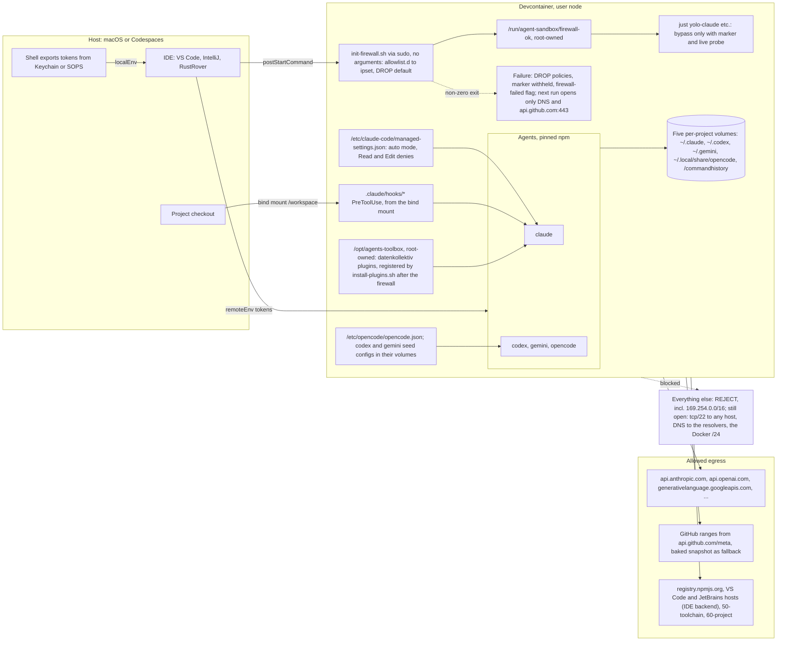

# Agent sandbox

The image runs Claude Code as user `node` behind a default-deny firewall; Codex, Gemini CLI and OpenCode are opt-in via `build.args.AGENTS`.
The agents install with their npm postinstall scripts and `/etc/profile.d/npm-global.sh` keeps them on `PATH` in login shells.
The smoke script's `<agent> installed` checks are the proof.
The datenkollektiv plugins are baked into the image when the project's `.devcontainer/toolbox/` exists; see Plugins inside.
Adapted from Anthropic's reference devcontainer: `init-firewall.sh` marks deviations inline with `toolbox:`, `Dockerfile` lists its own in its header comment, and `devcontainer.json` lists its own below.
Template version: see `VERSION`; `/refresh-agents` updates the toolbox-owned files.

## How it fits together



## First start
- Open the folder in VS Code ("Reopen in Container"), IntelliJ/RustRover (Dev Containers) or Codespaces.
- Docker Desktop on macOS must share the project path (Settings → Resources → File Sharing), or the start fails with `bind source path does not exist`.
- `postStartCommand` runs `sudo /usr/local/bin/init-firewall.sh`; it prints `Firewall active` on success.
- If the firewall fails, nothing beyond the rules already applied is reachable and the marker is withheld until a run succeeds; fix the cause and re-run the same command.
- `postStartCommand` then runs `install-plugins.sh`; it prints one line per marketplace and plugin it registers and skips what is already there.
- `just firewall-check` proves the state at any time; `just allowlist-check` prints the domain list on the host.

## Credentials
- Tokens are forwarded from the shell that launched the IDE: `CLAUDE_CODE_OAUTH_TOKEN`, `ANTHROPIC_API_KEY`, `OPENAI_API_KEY`, `GEMINI_API_KEY`.
- Set one of `CLAUDE_CODE_OAUTH_TOKEN` or `ANTHROPIC_API_KEY`; the API key wins when both are set.
- Claude: run `claude setup-token` on the host once a year and export the result before starting the IDE.

```bash
export CLAUDE_CODE_OAUTH_TOKEN="$(security find-generic-password -s claude-oauth-token -w)"   # Keychain
export CLAUDE_CODE_OAUTH_TOKEN="$(sops -d --extract '["CLAUDE_CODE_OAUTH_TOKEN"]' secrets.yaml)"  # SOPS
open -a "IntelliJ IDEA" .   # launch from this shell so ${localEnv:...} sees the export
```

- Dock-launched IDEs do not see shell exports; start the IDE from the terminal.
- Codex with a ChatGPT plan: run `codex login --device-auth` once; the login lives in the `~/.codex` volume.
- Gemini: API key only; Google-account login does not work inside the container.
- OpenCode: uses the forwarded provider keys; `/connect` logins persist in the `~/.local/share/opencode` volume.
- Codespaces: store the same names as Codespaces secrets; they arrive as env vars.
- Anything in env is readable by the agent and sendable to any host sharing an IP with the allowlist; only a host-side credential proxy (Docker Sandboxes `sbx secret set`, or an `ANTHROPIC_BASE_URL` proxy) avoids that, and this template does not provide one.
- `~/.ssh`, `~/.aws` and other host secrets are never mounted; VS Code forwards your SSH agent by default, so a loaded key is usable by the agent and tcp/22 egress is open.
- VS Code also copies `~/.gitconfig` in and forwards the host's HTTPS git credential helper by default, so `git push` over HTTPS reaches every repository the host credential can.
- Opt out with `"dev.containers.copyGitConfig": false` and `"dev.containers.gitCredentialHelperConfigLocation": "none"` under `customizations.vscode.settings`, then `gh auth login` inside with a scoped token; the image already routes `github.com` credentials through `gh`.

## Change agents, versions, domains
- Agents: edit `build.args.AGENTS` in `devcontainer.json` (space-separated from `claude codex gemini opencode`), rebuild.
- Each agent costs image size: claude ~330 MB, codex ~390 MB, gemini ~100 MB, opencode ~490 MB on arm64.
- Measured 2026-11-10 on arm64 before project features: 1.28 GB Claude-only (1.29 GB with the toolbox baked), 2.7 GB with all four; template 1.1.0 measured 1.24 GB Claude-only.
- The base is `node:22-bookworm-slim`; compilers and build libraries come from `features`, not from the image.
- `python3` is in the apt list because the security skills run `${CLAUDE_PLUGIN_ROOT}/scripts/*.py`; it is the Debian interpreter without pip, so a Python project still adds its toolchain via `features`.
- Versions: edit the `*_VERSION` args in `Dockerfile`, rebuild; auto-update is off everywhere.
- Bumping `JUST_VERSION` also means replacing `JUST_SHA256_X86_64` and `JUST_SHA256_AARCH64` from that release's `SHA256SUMS` asset.
- Install mode: Claude Code and OpenCode need their npm postinstall, which swaps a stub `bin/` for the native binary, so the image installs without `--ignore-scripts` (with the flag both exited 1 on `--version`, build of 2026-11-10).
- PATH: the agents live in `/usr/local/share/npm-global/bin`; Debian's `/etc/profile` drops it for non-root login shells (`bash -l`), so `/etc/profile.d/npm-global.sh` adds it back.
- Domains: edit `allowlist.d/50-toolchain.txt` or `60-project.txt`, rebuild; the firewall reads only the copy baked into the image.
- GitHub ranges come from `api.github.com/meta` at firewall start, with `/etc/devcontainer-firewall/github-meta.json` (snapshot taken at image build) as the fallback; rebuild to refresh it.
- Toolchains: add a `ghcr.io/devcontainers/features/*` entry to `features`; never edit `Dockerfile` or `init-firewall.sh` for a toolchain.
- Codex/Gemini seed files land in their volumes on first mount only; delete the `codex-config-*` or `gemini-config-*` volume to re-seed.

## Plugins inside
- `/onboard` Phase 5e copies the plugin-relevant toolbox tree into `.devcontainer/toolbox/`: `.claude-plugin`, `skills`, `shared`, `hooks`, `scripts`, `prompts` (about 1 MB).
- The `Dockerfile` bakes it root-owned to `/opt/agents-toolbox`; without `toolbox/` the build prints `no toolbox/ in build context` and succeeds.
- `install-plugins.sh` (chained into `postStartCommand` after the firewall, runs as `node`) registers `/opt/agents-toolbox` as a folder marketplace and installs every plugin in `marketplace.json` that is not `defaultEnabled: false`.
- Folder marketplaces load in place, so `/boy-scout`, `/onboard`, `/security-review` and friends run from `/opt/agents-toolbox`, not from a copy node can edit.
- The registration lives in the `~/.claude` volume; a rebuild keeps it, a deleted volume re-runs the install on the next create.
- The script is idempotent and works offline; re-run it by hand after changing the tree: `install-plugins.sh`.
- `/refresh-agents` Phase 3c re-copies `toolbox/` from the same root and replaces `install-plugins.sh`; rebuild to bake the new tree.
- The project's own `extraKnownMarketplaces` SSH entry never registers inside (no key); the folder marketplace is the model.
- OpenCode reads `~/.claude/skills/` and `CLAUDE.md`, not plugins; the baked tree does nothing for it.
- The toolbox's own `devcontainer/` never contains `toolbox/`; it would be a copy of the repo inside itself.

## Exchange directory
- Opt-in in `/onboard` Phase 5e: one host directory shared by every sandbox, for moving files in and out without `docker cp`.
- On yes, Phase 5e appends the mount below to the project's `devcontainer.json` and creates `~/sandbox-exchange/inbox` and `~/sandbox-exchange/outbox` on the host.
- Convention: `/exchange/inbox` carries files host → sandbox, `/exchange/outbox` carries deliverables sandbox → host; the mount itself is read-write in both directions.
- Not a template default: a missing bind source stops the container with `bind source path does not exist`.
- Docker Desktop on macOS must list the path under Settings → Resources → File Sharing, like the project path.
- Everything in `/exchange` is readable and writable by the agent; keep secrets out of it.
- Every sandbox on the machine reads and writes the same directory, so project A's agent sees project B's exports.
- The firewall never applies to this path: it is a persistent write channel to the host that survives `docker rm` and volume deletion.
- Treat its contents as untrusted: do not execute scripts from it, and check for symlinks before copying out, because a link the agent creates inside resolves on the host and is followed by `cat`, `cp -r`, Finder and IDE previews.
- Consider a per-project alternative first: a gitignored `exchange/` inside the repo is already bind-mounted at `/workspace/exchange`, scoped to that project, and needs no extra mount or File Sharing entry.

```bash
find ~/sandbox-exchange -type l   # list symlinks before copying anything out
```

```json
"source=${localEnv:HOME}/sandbox-exchange,target=/exchange,type=bind"
```

## Rust build cache
- Opt-in in `/onboard` Phase 5e on projects with a `Cargo.toml`: a tmpfs at `/rust-builds` and `CARGO_TARGET_DIR=/rust-builds/target`, so `target/` lives in RAM inside the sandbox.
- It is written as `runArgs`, because the devcontainer CLI accepts only `bind` and `volume` in `mounts`, and as the `--tmpfs` flag, because `--mount type=tmpfs` is `noexec` and Cargo runs build scripts from the target dir.
- The size is a cap, not a reservation; Phase 5e proposes about half the Docker Desktop VM memory (7.7 GB here, so `4g`) as a rule of thumb, not a measured figure, because tmpfs pages come out of that VM and the container has no memory limit of its own.
- The cache vanishes with the container, like a host RAM disk on reboot; nothing is shared with the host.
- Whether JetBrains and Codespaces honour `runArgs` is untested.
- `mode=0755,uid=1000,gid=1000` makes `node` the owner; a world-writable `1777` is not needed because no other user writes there.
- The `CARGO_TARGET_DIR` line goes inside the existing `containerEnv`; replacing the object drops the template's kill switches.

```json
"runArgs": ["--tmpfs", "/rust-builds:exec,size=4g,mode=0755,uid=1000,gid=1000"],
"containerEnv": { "...": "existing keys", "CARGO_TARGET_DIR": "/rust-builds/target" }
```

## Deviations in devcontainer.json
Listed here because the file stays pure JSON so `jq -e .` keeps working.
- `capAdd` replaces the reference's `runArgs --cap-add`; it is the orchestrator-neutral spec form.
- `postStartCommand` plus `waitFor` are the same lifecycle hooks as the reference; the firewall re-runs on every container start the IDE/CLI performs.
- `postStartCommand` chains `install-plugins.sh` after the firewall so the first `claude plugin` call never runs with open egress; the reference has no plugin step.
- Five named volumes instead of two; Codex, Gemini and OpenCode state persists alongside Claude's.
- `remoteEnv` forwards the four tokens from `${localEnv:...}`; `containerEnv` holds kill switches only, never a secret.
- `features` is empty by design; it is the toolchain slot `/onboard` Phase 5e fills.
- `hostRequirements` only filters Codespaces machine sizes.
- No `customizations.jetbrains.backend`; the IDE picker decides IntelliJ vs RustRover.

## Permissions inside
- Claude Code starts in `auto` mode from `/etc/claude-code/managed-settings.json`; the project's committed `.claude/settings.json` and its PreToolUse hooks load unchanged.
- `just yolo-claude|codex|gemini|opencode` opts into bypass for one process; each refuses on the host, without the firewall marker, or when example.com is reachable.
- The managed `Edit(path)` denies on `.devcontainer/`, `.claude/settings*.json`, `.claude/hooks/`, `.mcp.json` and `.git/` cover every file-editing tool; Bash redirection bypasses them.

## Platforms
| Runtime | Status |
|---|---|
| Docker Desktop (Apple silicon, kernel 7.x linuxkit) | verified 2026-11-10: firewall, caps, REJECT, `devcontainer up` on a real project |
| OrbStack | unverified; run `just firewall-check` on first start |
| Codespaces | unverified; secrets arrive as env, workspace path untested |
| IntelliJ / RustRover Dev Containers | unverified; backend libs are in the image, lifecycle support untested |

## Live checks (results go to docs/project-lore.md, not here)
| Check | Command |
|---|---|
| Auto mode active with nonessential traffic off | `claude`, then `/status`: mode auto, `Enterprise managed settings (file)` |
| Firewall up | `just firewall-check` |
| Hooks fire | `block-secret-reads.sh` denies a `cat .env` payload, command below |
| Empty `ANTHROPIC_API_KEY` does not shadow the OAuth token | `unset ANTHROPIC_API_KEY` on the host, start, `claude -p ok` |
| Each agent answers | one prompt per agent, commands below |
| Bypass refused on host | `just yolo-claude` outside the container exits 1 |
| JetBrains honours lifecycle | open in IntelliJ, then `just firewall-check` in the IDE terminal |

The hook check assumes `/onboard` Phase 5b installed `block-secret-reads.sh`; it is the only PreToolUse hook that phase wires into committed `.claude/settings.json`, while `just-enforcer.sh` lands in `settings.local.json` and also runs inside via the workspace bind mount.

```bash
echo '{"tool_name":"Bash","tool_input":{"command":"cat .env"}}' | .claude/hooks/block-secret-reads.sh   # expect permissionDecision deny
claude -p ok
codex exec --skip-git-repo-check ok
gemini -p ok
opencode run ok
```

## Limits
- DNS (udp/tcp 53) is open to the container's resolvers, so slow DNS exfiltration is possible.
- SSH (tcp/22) egress is open to any host, as in the reference.
- The Docker network's /24 (host gateway and every sibling container on that network) is allowed in both directions on all ports, as in the reference; run the sandbox on its own network if other containers have open egress.
- IPv4 A records only; IPv6 is dropped where ip6tables works and unfiltered otherwise.
- The allowlist is per IP, not per hostname; any service behind the same CDN or front-end IP (Google front ends, Cloudflare, Azure blob stamps) is reachable on any port.
- Without `NET_ADMIN` the firewall cannot start and the fail-closed trap cannot drop either; the network is then open and only `just yolo-*` refuses.
- A `docker stop`/`start` or Docker Desktop restart recreates the network namespace without the rules while the marker survives, and `postStartCommand` re-runs only on a container start the IDE/CLI performs, not on a bare `docker start`; until `sudo /usr/local/bin/init-firewall.sh` runs again the network is open and only `just yolo-*` probes for it.
- The agent may re-run `sudo init-firewall.sh`; a failed run keeps the DROP policies, and the next run opens only DNS to the pinned resolvers and tcp/443 to `api.github.com` while it resolves.
- A domain that fails to resolve fails the run; nothing beyond the rules already applied is reachable and the marker is withheld until it resolves or is removed from the allowlist and the image rebuilt.
- A failed or rate-limited `api.github.com/meta` fetch falls back to the build-time snapshot `/etc/devcontainer-firewall/github-meta.json`.
- Anyone with write access to this directory can weaken it; the next rebuild applies what is committed.
