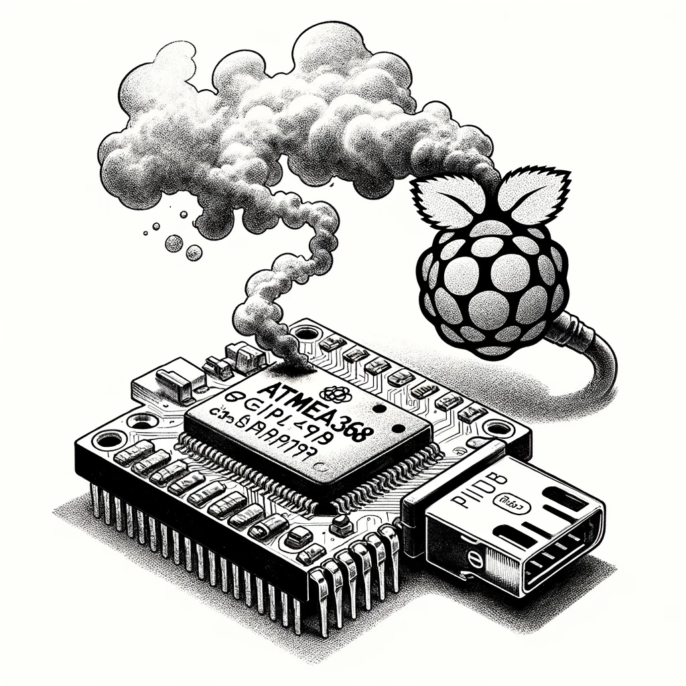

# AVR Burner

DALL-E: "please create a black and white sketch of a chip labeld Atmega368 with a thin smoke cloud and an attached Raspberry Pi"



TL;DR: `just run` (or `uv run --locked python app.py` without just) - open [`http://localhost:5001`](http://localhost:5001) in your browser.

The "AVR Burner" can be used to:

* Read the fuses of an ATmega328P, or
* flash a hex file to an ATmega328P.

Under the hood we use `avrdude` and a `usbasp` programmer.

Pre-requisites:

* `avrdude` installed,
* `just` and `uv` installed (see Setup), and
* `usbasp` programmer connected to the ATmega328P and the host (Raspberry Pi).

## Setup

```shell
sudo apt-get install avrdude just -y
curl -LsSf https://astral.sh/uv/install.sh | sh
uv sync --locked --no-dev
```

`--no-dev` installs only the runtime dependencies on the kiosk; for local development, `just install` also syncs the dev tools (ruff, mypy, pre-commit).

A kiosk autostart that runs `start.sh` needs `uv` on its `PATH` (the installer puts it in `~/.local/bin`). `pyproject.toml` requires uv `>=0.12,<1` (`[tool.uv] required-version`); update uv with `uv self update`.

### Upgrading from the old venv setup

Older checkouts used a venv in the repo root (`python3 -m venv .`, loaded via direnv). After `git pull`, remove the leftovers and sync:

```shell
rm -rf bin lib lib64 include share pyvenv.cfg
uv sync --locked --no-dev
```

Also run `direnv deny` (or remove the allow for the deleted `.envrc`) if you used direnv.

## (manually) Check the Fuses

Read the fuses to stdout:

```shell
avrdude -c usbasp -p m328p -U lfuse:r:-:h -U hfuse:r:-:h -U efuse:r:-:h
```

read the fuses from the ATmega328P and write the (hex) values to files:

```shell
avrdude -c usbasp -p m328p -U lfuse:r:low_fuse.hex:h -U hfuse:r:high_fuse.hex:h -U efuse:r:extended_fuse.hex:h
```

> Tip: On linux you might need to use `sudo` or check the permissions on the USB device, if you encounter: `error sending control message: Operation not permitted`.

## Known Issues

Tracked in [`docs/ROADMAP.md`](docs/ROADMAP.md) with design notes in [`docs/features/`](docs/features/).
